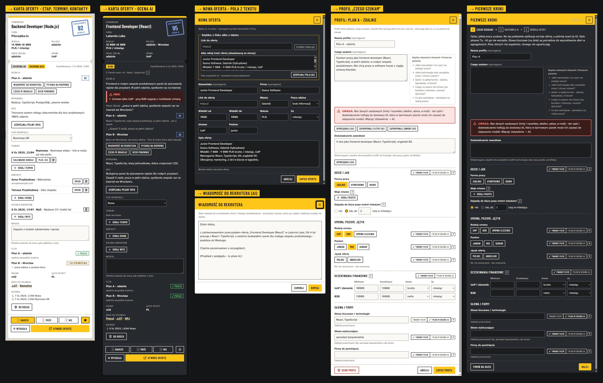

# Tablica Ofert

[](https://github.com/Bakeron/tablica-ofert/actions/workflows/tests.yml)

Aplikacja do prowadzenia własnych rekrutacji w jednym miejscu. Wkleja się link do ogłoszenia, a aplikacja wypełnia kartę oferty sama albo z pomocą AI (darmowe modele albo płatny Claude Sonnet). To samo ogłoszenie z kilku portali zwija się w jedną ofertę, więc CV nie trafia dwa razy w to samo miejsce. Aplikacja umie też sama zbierać oferty z agregatorów i maili z alertami portali.

Działa na Windows i Androidzie. Nie ma konta ani serwera, a dane leżą na urządzeniu w zaszyfrowanej bazie.

**[Zobacz wersję demo w przeglądarce](https://oferty.szymonbakonis.pl)** (zmyślone dane, zmiany znikają po odświeżeniu) · **[Instrukcja ze zrzutami ekranu](https://oferty.szymonbakonis.pl/instrukcja/)**

[English summary below](#in-english)

> Stan na 12.11.2026. Aplikacja na PC działa na prawdziwych danych (agregatory, alerty e-mail, AI, Harmonogram zadań). Wersja na Androida ma ten sam układ z zakładkami Własne, Zebrane i Kosz, drzewkiem ogłoszeń i ofertą z treści strony. Synchronizacja z telefonem przenosi też drzewko i pytania „To samo?”. Test na prawdziwym telefonie jeszcze przed nami.


## Co umie

- **Trzy zakładki** - „Własne” to rekrutacje użytkownika, z ofertami do wysłania CV na górze. „Zebrane” to oferty, które przyszły same, z widokiem „Najlepsze dziś” (ok. 15 najlepszych świeżych ofert według oceny AI). „Kosz” trzyma oferty odrzucone, wygasłe i usunięte.
- **AI niczego nie ukrywa** - ustawia tylko kolejność i przy ofercie pisze jedno zdanie, dlaczego dała taką ocenę.
- **Wygasłe oferty** - oferta, przy której nic się nie dzieje, po kilku dniach od publikacji sama trafia do Kosza. Rekrutacja w toku nigdy nie znika, dostaje tylko znacznik „Pewnie wygasła”.
- **Uczenie z ocen, bez AI** - oceny „Bardzo” i „Nie” podnoszą albo obniżają wynik podobnych ofert, najwyżej o 15 punktów. Karta pokazuje, które technologie zmieniły wynik. Wszystko liczy się na urządzeniu i da się to wyłączyć w Ustawieniach.
- **Wygląd tablicy odlotów** - jedna oferta zajmuje jeden wiersz ze stałymi kolumnami. Gdy coś się zmienia, moduł obraca się jak klapka, raz i w ok. 0,3 s.
- **Karta oferty jak karta pokładowa** - najważniejsze dane są nad perforacją, a ocena dopasowania wygląda jak pieczątka.
- **Drzewko ogłoszeń** - każde ogłoszenie z innego portalu ma pod wspólną ofertą własny status. Aplikacja łączy je sama tylko przy tej samej firmie, stanowisku i mieście. W razie wątpliwości pyta użytkownika, a przy innym tytule albo ukrytej firmie podpowiada AI. Odnowione ogłoszenie pokazuje różnice „było / jest”.
- **Etapy rekrutacji z historią** - od nowej oferty przez wysłanie CV i rozmowy aż po ofertę pracy. Przy ofercie jest też zainteresowanie „Bardzo / Może / Nie”, znacznik ulubionych i notatki.
- **Profile „czego szukam”** - np. osobny profil na pracę zdalną i osobny na jedno miasto, widoczne jako żółte znaki kierunkowe nad listą. Każdy ma opis własnymi słowami, formę pracy, miasta, umowę, poziom, język i widełki. Przy pierwszym uruchomieniu pomaga okno „Pierwsze kroki”.
- **Twarde filtry bez AI** - każda oferta dostaje wynik „pasuje”, „do sprawdzenia” albo „nie pasuje”, zawsze z powodem. Filtr czyta całą treść, więc zauważy „możliwa praca zdalna” w opisie oferty z Wrocławia. Odrzuca tylko to, co na pewno nie pasuje.
- **Oferty zbierają się same** - z alertów e-mail portali (JJIT, NFJ, Pracuj, theprotocol, Rocket Jobs, Bulldogjob, LinkedIn, Indeed, Jooble) i z API Adzuny, Jooble, Remotive, Himalayas, We Work Remotely i Remote OK. Skrzynka jest otwierana tylko do odczytu. Zbieranie działa przy starcie, co kilka godzin i przez Harmonogram zadań Windows także przy zamkniętej aplikacji. Portali aplikacja nie przegląda automatem, bo nie pozwalają na to ich regulaminy.
- **Oferta z treści strony** - link otwiera się w oknie podglądu, które działa jak tryb incognito. Aplikacja zabiera tekst strony, obcina menu i stopkę, a pola uzupełnia AI albo zwykły kod. Każde pole od AI musi mieć pokrycie w treści oferty. Gdy w treści jest np. kwota, a pole zostało puste, aplikacja zaznacza je na żółto razem z fragmentem źródłowym.
- **AI darmowe albo płatne** - darmowe modele (Groq, OpenRouter, Ollama na własnym komputerze) mogą same oceniać zebrane oferty. Gdy jeden dostawca odmówi, aplikacja pyta następnego. Płatny Claude Sonnet 5.5 jest wyraźnie dokładniejszy, ale działa tylko po kliknięciu i ma dzienny limit wydatków. Oba rodzaje nigdy nie pracują naraz. Bez AI ocena liczy się ze słów kluczowych.
- **Uczciwie o AI** - każdy dostawca ma opis dokładności i przycisk „Sprawdź połączenie”, który podaje powód błędu zwykłymi słowami. Przy Claude jest licznik wydatków w $ i w zł po kursie NBP oraz szacowany koszt przed oceną wszystkich ofert.
- **Jedno zapytanie na ofertę** - AI uzupełnia brakujące pola, pisze streszczenie i ocenia dopasowanie do każdego profilu z powodem i cytatem. Cytat zostaje tylko wtedy, gdy naprawdę jest w ofercie. Na kliknięcie AI pisze też wiadomość do rekrutera, pytania na rozmowę i listę braków względem oferty.
- **AI w profilu** - podpowiada filtry i zawody, które łączą posiadane umiejętności. Opis profilu porządkuje i pokazuje obie wersje do porównania.
- **Terminy i kontakty** - rozmowy i zadania mają przypomnienie dzień i godzinę przed. Aplikacja zaznacza też brak odpowiedzi od 7 dni. Termin można dodać do Kalendarza Google albo zapisać jako plik `.ics`. Przy ofercie są kontakty i historia kontaktów.
- **Kosz** - oferty można przywrócić albo usunąć na zawsze. Usunięta oferta nie wraca przy następnym pobieraniu.
- **Dane** - kopię zaszyfrowaną własnym hasłem da się wczytać na innym komputerze. Eksport do Excela (CSV) ma ochronę przed formułami. Wszystkie dane można też usunąć jednym przyciskiem.
- **Szybkie przeglądanie** - na PC ofertę ocenia się klawiszem i od razu przechodzi do następnej. Na telefonie służy do tego przesunięcie karty w prawo albo w lewo. Lista klawiszy jest w instrukcji.
- **Telefon z Androidem** - wersja na telefon ma dolny pasek zakładek i przypomnienia o terminach. Ofertę można udostępnić z przeglądarki prosto do aplikacji. Z komputerem telefon synchronizuje się przez Google Dysk po zeskanowaniu kodu QR.
- Aplikacja ma motyw ciemny i jasny, ograniczenie animacji oraz wersję polską i angielską.

Pomysł na wygląd to tablica odlotów i znaki kierunkowe. Tablica jest grafitowa, akcenty mają sygnałowy żółty, a piktogramy są rysowane kreską. Z lotniska pochodzi tylko wygląd i ruch, a napisy mówią językiem rekrutacji.

Zrzuty pochodzą z wersji na PC, na zmianę w motywie jasnym i ciemnym. Po kliknięciu obraz otwiera się w pełnym rozmiarze.





## Technologie i dlaczego

| Część | Technologia | Dlaczego |
|---|---|---|
| Aplikacja | [Tauri 2](https://tauri.app/) | kilka MB zamiast ok. 150 MB Electrona (okno przez WebView2 z Windows), praca w tle w Rust, ścisłe uprawnienia, później Android z tego samego projektu |
| Interfejs | React 19 + TypeScript, Vite | typy pilnują zgodności z zapleczem, popularne w ofertach pracy |
| Zaplecze | Rust | baza, zbieranie ofert w tle, sejf systemu, sprawdzanie danych z zewnątrz pole po polu |
| Sieć | reqwest (TLS systemu na PC, rustls na Androidzie), limit rozmiaru odpowiedzi | Adzuna, Remotive, Jooble, Himalayas, Remote OK, We Work Remotely (RSS) i dostawcy AI, dwa rodzaje API (zgodne z OpenAI i Anthropic Messages) zamiast osobnej biblioteki na każdego |
| Poczta | imap + mail-parser | odczyt alertów przez `EXAMINE` i `BODY.PEEK`, więc skrzynka zostaje nietknięta |
| Praca w tle | Harmonogram zadań Windows (`schtasks`), powiadomienia Windows | zbieranie i przypomnienia przy zamkniętej aplikacji bez autostartu z Windows |
| Dane | SQLite + SQLCipher | jeden zaszyfrowany plik, bo są w nim notatki i kontakty. Klucz leży w Menedżerze poświadczeń Windows, więc nie trzeba wpisywać hasła |
| Zapis | transakcje, migracje, 5 kopii przy starcie | zapis w całości albo wcale, a błąd odczytu blokuje zapis zamiast startu z pustą listą |
| Pismo | Barlow Condensed, Atkinson Hyperlegible Next (SIL OFL) | wąskie, równe litery na tablicę i krój pod czytelność w treści, wbudowane, bez internetu |
| Testy | `cargo test` (ok. 330), Vitest (ok. 90), GitHub Actions | baza na zaszyfrowanym pliku tymczasowym, zmyślone maile z alertami i odpowiedzi API i AI. Po każdym `push` to samo na czystym Windowsie |

## Budowa projektu

| Folder | Co tam jest |
|---|---|
| `src/` | interfejs (React + TypeScript), w nim `components/` (ekrany i okna), `lib/` (logika bez wyglądu, z testami `*.test.ts`), `api/` (wywołania zaplecza i ich typy, `types.ts` = `model.rs`), `i18n/` (teksty po polsku i angielsku), `demo/` i `api/mock.ts` (wersja demo z przykładowymi danymi) |
| `src-tauri/src/` | zaplecze (Rust), w nim `commands.rs` (funkcje dla interfejsu, sprawdzają dane i oddają je dalej), `offers.rs` (oferty), `filter.rs` (twarde filtry), `ai/` (dostawcy AI), `sources/` (agregatory i alerty e-mail), `sync/` (synchronizacja z telefonem), `db.rs` + `migrations/` (baza i jej zmiany), `secrets.rs` (sejf systemu) |
| `src-tauri/gen/android/` | projekt Androida wygenerowany przez Tauri, z małą zmianą dla „Udostępnij” z przeglądarki do aplikacji |
| `instrukcja/` | instrukcja dla użytkownika, zrzuty robi skrypt `npm run instrukcja` (Playwright) |
| `scripts/` | budowa APK, zrzuty do instrukcji, lista licencji bibliotek |

Prawie każdy plik Rust zaczyna się od krótkiego opisu, co robi i dlaczego.

## Instalacja

Instalator `.exe` na Windows 10/11 powstaje poleceniem `npm run tauri build` (opis niżej). Gotowe wydania do pobrania pojawią się na GitHubie.

> Aplikacja nie ma jeszcze płatnego podpisu cyfrowego, dlatego Windows albo antywirus (np. Avast) mogą przy pierwszym uruchomieniu sprawdzać ją przez kilka sekund albo pokazać ostrzeżenie. To normalne dla nowych, mało znanych programów.

Ta sama informacja jest na pierwszej stronie instalatora, z polem „Rozumiem”. Antywirus może też sprawdzać sam instalator, zanim ten się otworzy.

## Uruchomienie

Do zbudowania potrzebne są Windows 10/11, [Node.js](https://nodejs.org/) 24, [Rust](https://rustup.rs/), Visual Studio Build Tools (C++) i [Strawberry Perl](https://strawberryperl.com/), który buduje OpenSSL dla SQLCipher.

```powershell
npm install
npm run tauri dev      # aplikacja
npm run dev            # sam interfejs w przeglądarce, z przykładowymi danymi
npm test               # testy interfejsu
npm run test:rust      # testy zaplecza
npm run tauri build    # instalator
```

Pierwsza kompilacja trwa kilkanaście minut, bo OpenSSL buduje się ze źródeł. Kolejne trwają kilka sekund.

## Prywatność

- Aplikacja nie ma konta, serwera ani własnej analityki. Wyjątkiem jest skaner kodu QR na telefonie, który korzysta z ML Kit Google (opis w `PRIVACY.md`). Nie wczytuje czcionek ani skryptów z internetu, a pilnuje tego ścisłe CSP.
- Baza jest zaszyfrowana. Jej klucz, klucze API i hasło do skrzynki leżą w sejfie systemu i nigdy nie trafiają do kopii, eksportu ani zapytania do AI. Jedynym wyjątkiem jest zapasowa kopia klucza bazy w pliku zaszyfrowanym przez Windows (DPAPI), czytelna tylko na koncie Windows użytkownika.
- Okno podglądu stron nie ma dostępu do aplikacji. Teksty z zewnątrz (maile, API, AI, strony) nigdy nie są pokazywane jako HTML.
- Aplikacja nigdy sama nie wysyła CV ani zgłoszeń i nie przegląda portali automatem. Oferty przychodzą z alertów e-mail, oficjalnych API i od użytkownika.
- Pełna polityka jest w [`PRIVACY.md`](PRIVACY.md).

## Jak powstaje z AI

Cały kod napisał [Claude Code](https://claude.com/claude-code), a ja projektowałem przepływ, pilnowałem testów i sprawdzałem każdą zmianę. Podział pracy jest stały.

- **Ja decyduję** - najpierw powstały założenia z pytaniami, odpowiedziami i odrzuconymi wariantami, a dopiero potem kod. Każda nowa technologia, źródło ofert czy zmiana wyglądu czeka na moją decyzję. Plan pracy i sprawy wymagające człowieka (konta, klucze, testy na prawdziwych danych) prowadzę w notatkach poza repozytorium.
- **AI pisze** - Claude Code pisze kod w Rust i React, testy, migracje bazy, teksty interfejsu w dwóch językach i dokumentację.
- **Wszystko jest sprawdzane** - testy idą po każdej zmianie, a zrzuty ekranu w obu motywach po każdej zmianie wyglądu. Przed nowym źródłem ofert sprawdzam regulamin i warunki API. Okresowe audyty obejmują dostępność i kontrast, teksty, zależności i licencje oraz bezpieczeństwo danych z zewnątrz. Poprawki z nich trafiają do zwykłych commitów.
- **Zasady dla AI** - leżą w osobnym pliku dla Claude Code poza repozytorium. Opisują, gdzie co leży, jak uruchamiać aplikację i czego nie wolno, np. zmieniać istniejącej migracji bazy.

## Licencja

[MIT](LICENSE).

---

## In English

Tablica Ofert ("Job Board") is a personal job-search organizer for Windows and Android. A link to a job ad goes in, and the app fills in the offer card by itself or with AI (free models or paid Claude Sonnet).

- The same ad from several job portals folds into one offer, so a CV never goes twice to the same place.
- New offers arrive on their own from job aggregator APIs and job-alert emails (the mailbox is read-only).
- Hard filters and an AI match score for each search profile, always with a reason.
- Recruitment stages with history, reminders and contacts.
- An encrypted local database with no account and no server. The phone syncs with the PC through Google Drive.

Technologies: Tauri 2, Rust, React + TypeScript, SQLite with SQLCipher, Android.

Demo with made-up data: [oferty.szymonbakonis.pl](https://oferty.szymonbakonis.pl/?lang=en). All the code was written by Claude Code, while I designed the flow, kept an eye on the tests and reviewed every change. The full description is in Polish above.
