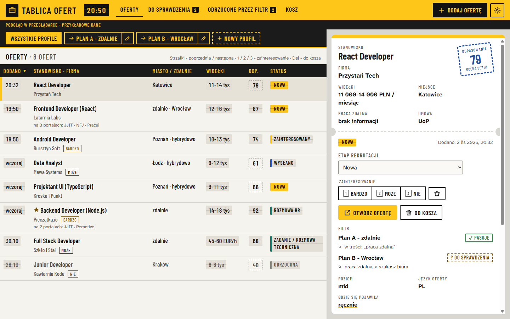
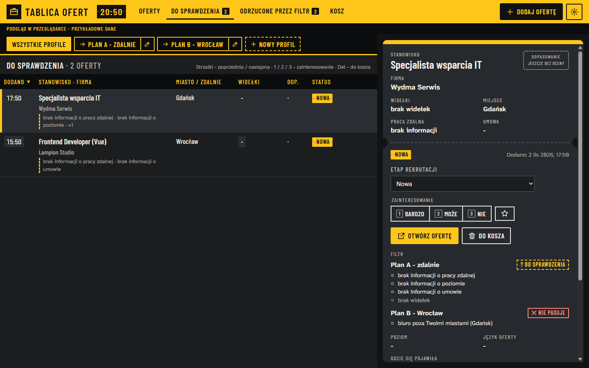
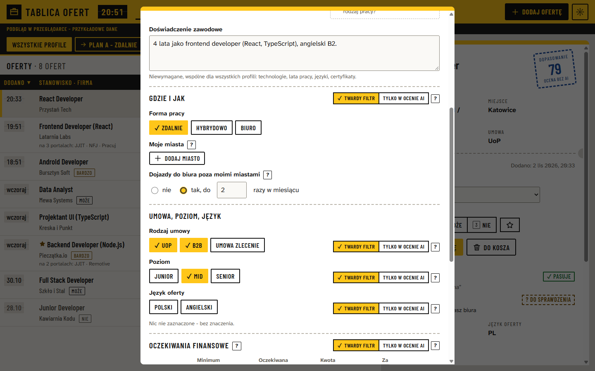

# Tablica Ofert

Osobista tablica do szukania pracy na Windows: oferty z wielu źródeł w jednym miejscu, jedna oferta z kilku portali jako jeden wiersz, etapy rekrutacji z historią, notatki i kosz, z którego usunięte oferty już nie wracają. Bez konta i bez serwera - dane leżą na komputerze, w zaszyfrowanej bazie.

> **Stan (2.11.2026):** pierwsza część etapu 1 - tablica, karta oferty, ręczne dodawanie, zaszyfrowana baza, profile „czego szukam” i twarde filtry. Automatyczne zbieranie ofert (alerty e-mail, Adzuna, Remotive) i ocena AI są w budowie - plan w [`robota.md`](robota.md).


> **In English:** a personal job-search board for Windows built with Tauri 2 (Rust + React/TypeScript). Offers from several sources become one row, recruitment stages are tracked with history, data stays on the device in a SQLCipher-encrypted SQLite database whose key lives in Windows Credential Manager. Built with Claude Code as a pair programmer: the author set the requirements and made the decisions, Claude wrote the code, tests and audits. Docs are in Polish, code and comments in English.

## Co umie (na dziś)

- **Tablica jak na lotnisku** - jeden wiersz = jedna oferta, stałe kolumny (dodano, stanowisko i firma, miasto / zdalnie, widełki, dopasowanie, status). Gdy coś się zmienia, moduł obraca się jak klapka - raz, ok. 0,3 s.
- **Karta oferty w kształcie karty pokładowej** - najważniejsze dane na odcinku nad perforacją, ocena dopasowania jako pieczątka.
- **Ta sama oferta z kilku portali = jeden wiersz** („na 3 portalach: JJIT · NFJ · Pracuj”); brakujące dane uzupełniają się z kolejnych źródeł.
- **Etapy rekrutacji z historią** (nowa → wysłano → rozmowa HR → … → oferta pracy), zainteresowanie „bardzo / może / nie”, ulubione, notatki.
- **Profile „czego szukam”** (np. „Plan A - zdalnie”, „Plan B - Wrocław”) jako znaki kierunkowe nad tablicą: opis własnymi słowami, forma pracy, miasta z odległością, umowa, poziom, język, minimalne i oczekiwane widełki (UoP / B2B), firmy i słowa do pominięcia. Przy pierwszym uruchomieniu - „Pierwsze kroki”.
- **Twarde filtry bez AI** - wynik „pasuje / nie pasuje / niepewne”. Filtr czyta całą treść oferty („Wrocław”, a w opisie „możliwa praca zdalna”; „raz w miesiącu w biurze”) i odrzuca tylko to, co na pewno nie pasuje. Niepewne trafiają do zakładki „Do sprawdzenia”, odrzucone - do „Odrzucone przez filtr”, zawsze z powodem.
- **Kosz** - przywróć albo usuń na zawsze; usunięta oferta nie wróci przy następnym pobieraniu.
- **Bez myszy** - strzałki, 1 / 2 / 3 (zainteresowanie), Del (do kosza), Enter (karta).
- Motyw ciemny i jasny, ograniczenie animacji, polski i angielski.

Pomysł na wygląd: **tablica odlotów i znaki kierunkowe** - grafitowa tablica, żółty sygnałowy, piktogramy z kreski. Z lotniska jest tylko wygląd i ruch, napisy mówią językiem rekrutacji.







## Technologie i dlaczego

| Część | Technologia | Dlaczego |
|---|---|---|
| Aplikacja | [Tauri 2](https://tauri.app/) | kilka MB zamiast ok. 150 MB Electrona (okno przez WebView2 z Windows), praca w tle w Rust, ścisłe uprawnienia, później Android z tego samego projektu |
| Interfejs | React 19 + TypeScript, Vite | typy pilnują zgodności z zapleczem, popularne w ofertach pracy |
| Zaplecze | Rust | baza, zbieranie ofert w tle, sejf systemu |
| Dane | SQLite + SQLCipher | jeden plik, zaszyfrowany (są w nim notatki i kontakty); klucz w Menedżerze poświadczeń Windows - bez hasła do wpisywania |
| Zapis | transakcje, migracje, 5 kopii przy starcie | zapis w całości albo wcale; błąd odczytu blokuje zapis zamiast startu z pustą listą |
| Pismo | Barlow Condensed, Atkinson Hyperlegible Next (SIL OFL) | wąskie, równe litery na tablicę i krój pod czytelność w treści; wbudowane, bez internetu |
| Testy | `cargo test`, Vitest | baza na zaszyfrowanym pliku tymczasowym, zmyślone dane |

Pełne założenia i odrzucone alternatywy: [`zalozenia.md`](zalozenia.md).

## Uruchomienie

Potrzebne: Windows 10/11, [Node.js](https://nodejs.org/) 24, [Rust](https://rustup.rs/), Visual Studio Build Tools (C++), [Strawberry Perl](https://strawberryperl.com/) (do zbudowania OpenSSL dla SQLCipher).

```powershell
npm install
npm run tauri dev      # aplikacja
npm run dev            # sam interfejs w przeglądarce, z przykładowymi danymi
npm test               # testy interfejsu
npm run test:rust      # testy zaplecza
npm run tauri build    # instalator
```

Pierwsza kompilacja trwa kilkanaście minut (OpenSSL budowany ze źródeł), kolejne - kilka sekund.

## Prywatność

- Bez konta, bez serwera, bez analityki, bez czcionek i skryptów z internetu (ścisłe CSP).
- Baza zaszyfrowana; klucz tylko w sejfie systemu.
- Aplikacja nigdy sama nie wysyła CV ani zgłoszeń i nie przegląda portali automatem - oferty będą przychodzić z alertów e-mail, oficjalnych API i z rąk użytkownika (szczegóły i sprawdzone regulaminy w `zalozenia.md` §3).

## Jak powstaje - praca z Claude Code

Autor ustala założenia i podejmuje decyzje (`zalozenia.md` - najpierw pytania i odpowiedzi, potem kod), Claude Code pisze kod, testy i dokumentację i sprawdza wygląd zrzutami ekranu. Audyty (dostępność, wygląd, teksty, testy, zależności, wydanie, portfolio) są w `.claude/skills/`.

## Licencja

[MIT](LICENSE).
