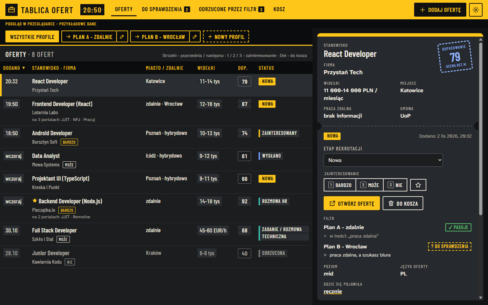
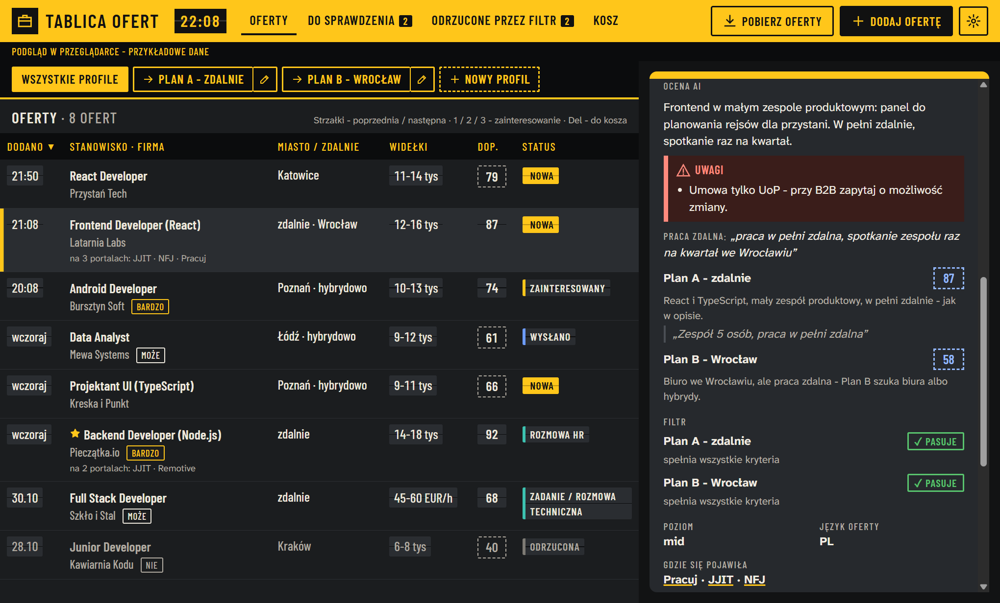
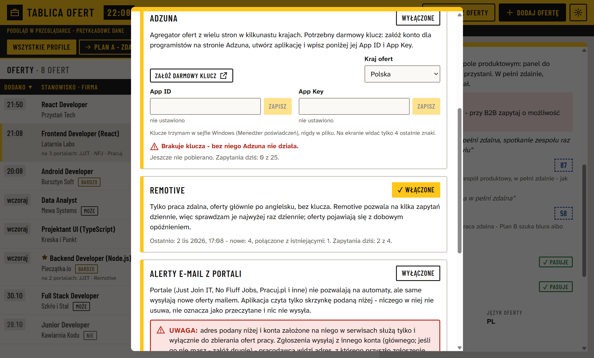
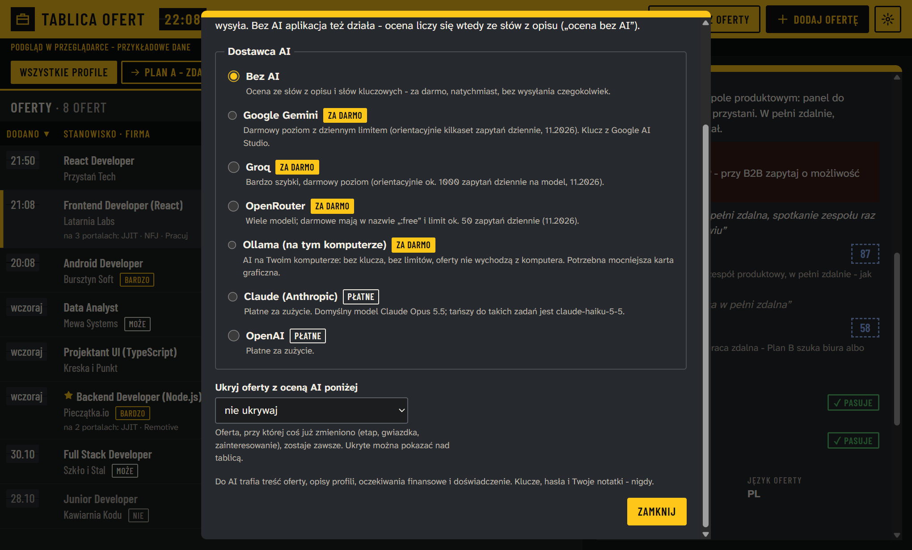

# Tablica Ofert

Osobista tablica do szukania pracy na Windows: sama zbiera nowe oferty z legalnych źródeł (alerty e-mail z portali, Adzuna, Remotive, Jooble, We Work Remotely, Remote OK), odsiewa je Twoimi filtrami, ocenia z pomocą AI (albo bez AI - ze słów) i przypomina o rozmowach. Jedna oferta z kilku portali to jeden wiersz, etapy rekrutacji mają historię. Bez konta i bez serwera - dane leżą na komputerze, w zaszyfrowanej bazie.

> **Stan (2.11.2026):** etap 1 (aplikacja na PC) gotowy w kodzie i sprawdzony testami na zmyślonych danych; czeka na test z prawdziwymi kluczami i skrzynką. Dalej: synchronizacja z telefonem przez Google Dysk i aplikacja na Androida - plan w [`robota.md`](robota.md).



> **In English:** a personal job-search board for Windows built with Tauri 2 (Rust + React/TypeScript). It collects offers from legal sources only (job-portal e-mail alerts over read-only IMAP, the Adzuna, Remotive, Jooble and Remote OK APIs, the We Work Remotely feed), filters them with plain-code hard filters, scores them with a swappable AI provider (Gemini, Groq, OpenRouter, Ollama, Claude, OpenAI - or keyword scoring without AI) and reminds about interviews through Windows notifications and Task Scheduler. Data stays on the device in a SQLCipher-encrypted SQLite database whose key lives in Windows Credential Manager. Built with Claude Code as a pair programmer: the author set the requirements and made the decisions, Claude wrote the code, tests and audits. Docs are in Polish, code and comments in English.

## Co umie

- **Tablica jak na lotnisku** - jeden wiersz = jedna oferta, stałe kolumny (dodano, stanowisko i firma, miasto / zdalnie, widełki, dopasowanie, status). Gdy coś się zmienia, moduł obraca się jak klapka - raz, ok. 0,3 s.
- **Karta oferty w kształcie karty pokładowej** - najważniejsze dane na odcinku nad perforacją, ocena dopasowania jako pieczątka.
- **Ta sama oferta z kilku portali = jeden wiersz** („na 3 portalach: JJIT · NFJ · Pracuj”); brakujące dane uzupełniają się z kolejnych źródeł.
- **Etapy rekrutacji z historią** (nowa → wysłano → rozmowa HR → … → oferta pracy), zainteresowanie „bardzo / może / nie” (oferty z „nie” czekają w osobnej zakładce „Nie dla mnie”), ulubione, notatki.
- **Profile „czego szukam”** (np. „Plan A - zdalnie”, „Plan B - Wrocław”) jako znaki kierunkowe nad tablicą: opis własnymi słowami, forma pracy, miasta z odległością, umowa, poziom, język, minimalne i oczekiwane widełki (UoP / B2B), firmy i słowa do pominięcia. Przy pierwszym uruchomieniu - „Pierwsze kroki”.
- **Twarde filtry bez AI** - wynik „pasuje / nie pasuje / niepewne”. Filtr czyta całą treść oferty („Wrocław”, a w opisie „możliwa praca zdalna”; „raz w miesiącu w biurze”) i odrzuca tylko to, co na pewno nie pasuje. Niepewne trafiają do zakładki „Do sprawdzenia”, odrzucone - do „Odrzucone przez filtr”, zawsze z powodem.
- **Oferty zbierają się same** - z alertów e-mail portali (JJIT, NFJ, Pracuj, theprotocol, Rocket Jobs, Bulldogjob, LinkedIn, Indeed; skrzynka tylko do odczytu), z Adzuny i Jooble (darmowe klucze użytkownika) oraz Remotive, We Work Remotely i Remote OK (praca zdalna, bez kluczy; z dwóch ostatnich zostają tylko oferty ze słowami kluczowymi profilu). Przy starcie, co kilka godzin i - przez Harmonogram zadań Windows - także przy zamkniętej aplikacji, z powiadomieniem o nowych ofertach. Każde źródło pilnuje swoich limitów zapytań. Portali aplikacja nie przegląda automatem (regulaminy - `zalozenia.md` §3).
- **Z linku albo z tekstu** - link otwiera się w oknie podglądu, „Pobierz treść ze strony” zabiera tekst otwartej strony, a pola uzupełnia AI albo zwykły kod.
- **AI do wyboru** - darmowe (Gemini, Groq, OpenRouter, Ollama na własnym komputerze) albo płatne (Claude, OpenAI). Jedno zapytanie na ofertę: brakujące pola, streszczenie, „Uwagi”, ocena dopasowania do każdego profilu z powodem i cytatem z oferty (cytat zostaje tylko, gdy naprawdę jest w ofercie). Dzienny limit zapytań, „Sprawdź mój komputer” przy Ollamie. Na kliknięcie: wiadomość do rekrutera, pytania na rozmowę, „Czego mi brakuje”. W profilu: „Zaproponuj filtry” i „Uporządkuj” opis z porównaniem obu wersji. Bez AI ocena liczy się ze słów.
- **Terminy i kontakty** - rozmowy i terminy zadań z przypomnieniem dzień i godzinę przed, „brak odpowiedzi od 7 dni”, „Dodaj do kalendarza” (Kalendarz Google albo plik `.ics`), kontakty i historia kontaktów przy ofercie.
- **Kosz** - przywróć albo usuń na zawsze; usunięta oferta nie wróci przy następnym pobieraniu.
- **Dane** - kopia w pliku zaszyfrowanym własnym hasłem (da się ją wczytać na innym komputerze), eksport do Excela (CSV z ochroną przed formułami), „Usuń wszystkie dane”.
- **Bez myszy** - strzałki, 1 / 2 / 3 (zainteresowanie), Del (do kosza), Enter (karta).
- Motyw ciemny i jasny, ograniczenie animacji, polski i angielski.

Pomysł na wygląd: **tablica odlotów i znaki kierunkowe** - grafitowa tablica, żółty sygnałowy, piktogramy z kreski. Z lotniska jest tylko wygląd i ruch, napisy mówią językiem rekrutacji.








## Technologie i dlaczego

| Część | Technologia | Dlaczego |
|---|---|---|
| Aplikacja | [Tauri 2](https://tauri.app/) | kilka MB zamiast ok. 150 MB Electrona (okno przez WebView2 z Windows), praca w tle w Rust, ścisłe uprawnienia, później Android z tego samego projektu |
| Interfejs | React 19 + TypeScript, Vite | typy pilnują zgodności z zapleczem, popularne w ofertach pracy |
| Zaplecze | Rust | baza, zbieranie ofert w tle, sejf systemu, sprawdzanie danych z zewnątrz pole po polu |
| Sieć | reqwest (TLS systemu), limit rozmiaru odpowiedzi | Adzuna, Remotive, Jooble, Remote OK, We Work Remotely (RSS), dostawcy AI - dwa rodzaje API (zgodne z OpenAI i Anthropic Messages) zamiast osobnej biblioteki na każdego |
| Poczta | imap + mail-parser | odczyt alertów: `EXAMINE` i `BODY.PEEK`, więc skrzynka zostaje nietknięta |
| Praca w tle | Harmonogram zadań Windows (`schtasks`), powiadomienia Windows | zbieranie i przypomnienia przy zamkniętej aplikacji bez autostartu z Windows |
| Dane | SQLite + SQLCipher | jeden plik, zaszyfrowany (są w nim notatki i kontakty); klucz w Menedżerze poświadczeń Windows - bez hasła do wpisywania |
| Zapis | transakcje, migracje, 5 kopii przy starcie | zapis w całości albo wcale; błąd odczytu blokuje zapis zamiast startu z pustą listą |
| Pismo | Barlow Condensed, Atkinson Hyperlegible Next (SIL OFL) | wąskie, równe litery na tablicę i krój pod czytelność w treści; wbudowane, bez internetu |
| Testy | `cargo test` (ok. 100), Vitest | baza na zaszyfrowanym pliku tymczasowym, zmyślone maile z alertami i odpowiedzi API / AI |

Pełne założenia i odrzucone alternatywy: [`zalozenia.md`](zalozenia.md).

## Instalacja

Instalator `.exe` (Windows 10/11) powstaje poleceniem `npm run tauri build` - poniżej. Wydania do pobrania z GitHuba - wkrótce.

> Aplikacja nie ma jeszcze płatnego podpisu cyfrowego, dlatego Windows albo antywirus (np. Avast) mogą przy pierwszym uruchomieniu sprawdzać ją przez kilka sekund albo pokazać ostrzeżenie. To normalne dla nowych, mało znanych programów.

Ta sama informacja jest na pierwszej stronie instalatora (z polem „Rozumiem”); antywirus może sprawdzać sam instalator, zanim ten się otworzy.

## Uruchomienie

Potrzebne: Windows 10/11, [Node.js](https://nodejs.org/) 24, [Rust](https://rustup.rs/), Visual Studio Build Tools (C++), [Strawberry Perl](https://strawberryperl.com/) (do zbudowania OpenSSL dla SQLCipher).

```powershell
npm install
npm run tauri dev      # aplikacja
npm run dev            # sam interfejs w przeglądarce, z przykładowymi danymi
npm test               # testy interfejsu
npm run test:rust      # testy zaplecza
npm run tauri build    # instalator
```

Pierwsza kompilacja trwa kilkanaście minut (OpenSSL budowany ze źródeł), kolejne - kilka sekund.

## Prywatność

- Bez konta, bez serwera, bez analityki, bez czcionek i skryptów z internetu (ścisłe CSP).
- Baza zaszyfrowana; jej klucz, klucze API i hasło do skrzynki tylko w sejfie systemu - nigdy w pliku, kopii, eksporcie ani w zapytaniu do AI.
- Okno podglądu stron nie ma dostępu do aplikacji; teksty z zewnątrz (maile, API, AI, strony) nigdy nie są pokazywane jako HTML.
- Aplikacja nigdy sama nie wysyła CV ani zgłoszeń i nie przegląda portali automatem - oferty przychodzą z alertów e-mail, oficjalnych API i z rąk użytkownika (szczegóły i sprawdzone regulaminy w `zalozenia.md` §3).
- Pełna polityka: [`PRIVACY.md`](PRIVACY.md).

## Jak powstaje - praca z AI

Aplikację piszę z [Claude Code](https://claude.com/claude-code). Podział jest stały:

- **Ja decyduję.** Najpierw założenia (`zalozenia.md` - pytania, odpowiedzi, odrzucone warianty), dopiero potem kod. Każda nowa technologia, źródło ofert czy zmiana wyglądu czeka na moją decyzję; plan pracy i sprawy, które wymagają człowieka (konta, klucze, testy na prawdziwych danych), są w `robota.md`.
- **AI pisze.** Kod Rust i React, testy, migracje bazy, teksty interfejsu w dwóch językach i dokumentację.
- **Wszystko jest sprawdzane.** Testy po każdej zmianie (`npm test`, `npm run test:rust` - zmyślone maile, odpowiedzi API i AI, baza na pliku tymczasowym); zrzuty ekranu w obu motywach po każdej zmianie wyglądu; przed nowym źródłem ofert - regulamin i warunki API (`zalozenia.md` §3); okresowe audyty (dostępność i kontrast, teksty, zależności i licencje, bezpieczeństwo danych z zewnątrz), a poprawki z nich trafiają do zwykłych commitów.
- **Zasady dla AI** są w [`CLAUDE.md`](CLAUDE.md): gdzie co leży, jak uruchamiać, czego nie wolno (np. prywatne dane w repozytorium, zmiana istniejącej migracji).

## Licencja

[MIT](LICENSE).
