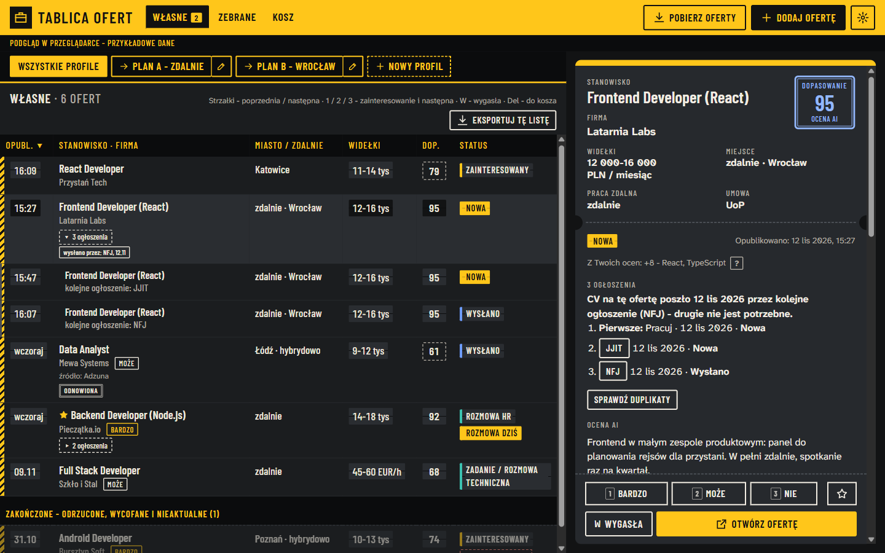
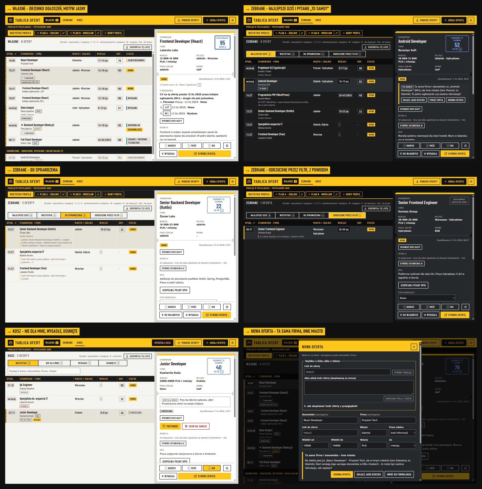
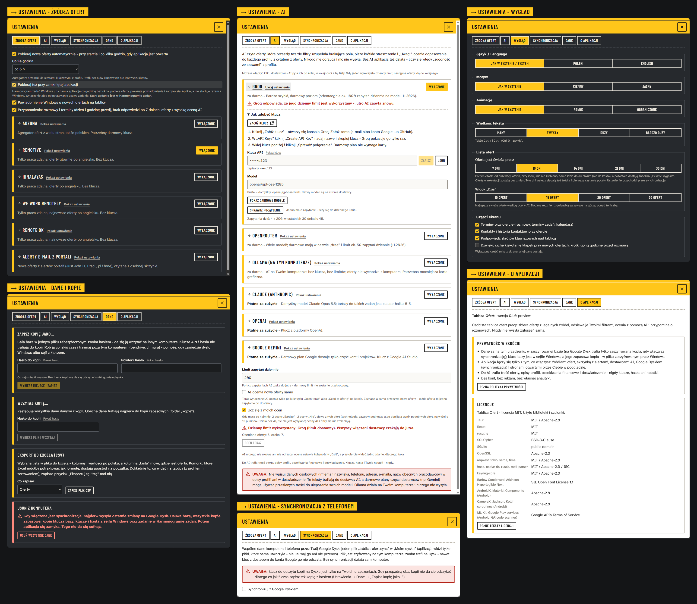

# Tablica Ofert

Osobista tablica do szukania pracy na Windows (i Androida): sama zbiera nowe oferty z legalnych źródeł (alerty e-mail z portali, Adzuna, Remotive, Jooble, Himalayas, We Work Remotely, Remote OK), odsiewa je Twoimi filtrami, ocenia z pomocą AI (albo bez AI - ze słów) i przypomina o rozmowach. Ta sama oferta z kilku portali to jedno drzewko ogłoszeń, etapy rekrutacji mają historię. Bez konta i bez serwera - dane leżą na komputerze, w zaszyfrowanej bazie.

> **Stan (12.11.2026):** aplikacja na PC działa na prawdziwych danych (agregatory, alerty e-mail, AI, Harmonogram zadań). Nowy układ z 11.11.2026 (zakładki Własne / Zebrane / Kosz, drzewko ogłoszeń, oferta z treści strony) działa też w wersji na Androida i przechodzi przez synchronizację z telefonem (drzewko i pytanie „To samo?” razem z ofertą); test na prawdziwym telefonie przed nami.



## Co umie

- **Trzy zakładki: Własne, Zebrane, Kosz** - „Własne” to Twoje rekrutacje: na górze oferty do wysłania CV, niżej wysłane i w toku. „Zebrane” to wszystko, co przyszło samo, z przełącznikiem „Najlepsze dziś” (ok. 15 najlepszych świeżych ofert według oceny AI) / „Wszystkie” / „Do sprawdzenia” / „Odrzucone przez filtr”; przycisk albo klawisz D przenosi ofertę do Własnych. Zbieranie można wyłączyć - zostają wtedy tylko Własne i Kosz. AI niczego nie ukrywa: ustawia kolejność i przy ofercie pisze jedno zdanie, dlaczego taka ocena. Oferta, przy której nic nie zrobisz, po ok. 10 dniach od publikacji sama idzie do Kosza (Wygasłe); ta, przy której pracujesz, dostaje znacznik „Pewnie wygasła”, a rekrutacja nigdy nie znika. Liczby da się zmienić w ustawieniach. Gdy sam otworzysz stronę oferty i pobierzesz jej treść, a strona pisze, że oferta wygasła, karta zaproponuje oznaczenie - nic nie dzieje się samo.
- **Uczenie z Twoich ocen, bez AI** - od 2 ocen „Bardzo” i 2 ocen „Nie” technologie i zawody z tych ofert podnoszą albo obniżają wynik podobnych ofert (najwyżej o 15 punktów), a karta pokazuje dlaczego, np. „Z Twoich ocen: +8 - WordPress, React”. Liczone na urządzeniu, ocena AI i filtry zostają bez zmian, wyłączane w Ustawieniach.
- **Tablica jak na lotnisku** - jeden wiersz = jedna oferta, stałe kolumny (data publikacji, stanowisko i firma, miasto / zdalnie, widełki, dopasowanie, status). Gdy coś się zmienia, moduł obraca się jak klapka - raz, ok. 0,3 s.
- **Karta oferty w kształcie karty pokładowej** - najważniejsze dane na odcinku nad perforacją, ocena dopasowania jako pieczątka.
- **Drzewko ogłoszeń** - ta sama oferta z kilku portali to pierwsze ogłoszenie i „3 ogłoszenia” pod nim, każde z własnym statusem („wysłano przez: NFJ, 5.11”). Łączy się samo tylko przy tej samej firmie, stanowisku i mieście; przy innym mieście albo innych widełkach pyta, a „pewnie to samo” (inny tytuł, ukryta firma) ocenia AI i decydujesz Ty. Odnowione ogłoszenie pokazuje różnice „było / jest” i aktualizuje się dopiero po kliknięciu.
- **Etapy rekrutacji z historią** (nowa → wysłano → rozmowa HR → … → oferta pracy), zainteresowanie „Bardzo / Może / Nie” (oferty z „Nie” czekają w Koszu, w „Nie dla mnie”), ulubione, notatki.
- **Profile „czego szukam”** (np. „Plan A - zdalnie”, „Plan B - Wrocław”) jako znaki kierunkowe nad tablicą: opis własnymi słowami, forma pracy, miasta z odległością, umowa, poziom, język, minimalne i oczekiwane widełki (UoP / B2B), firmy i słowa do pominięcia. Przy pierwszym uruchomieniu - „Pierwsze kroki”.
- **Twarde filtry bez AI** - wynik „pasuje / do sprawdzenia / nie pasuje”. Filtr czyta całą treść oferty („Wrocław”, a w opisie „możliwa praca zdalna”; „raz w miesiącu w biurze”) i odrzuca tylko to, co na pewno nie pasuje. Oferty do sprawdzenia trafiają do „Do sprawdzenia”, odrzucone - do „Odrzucone przez filtr” (obie w Zebranych), zawsze z powodem.
- **Oferty zbierają się same** - z alertów e-mail portali (JJIT, NFJ, Pracuj, theprotocol, Rocket Jobs, Bulldogjob, LinkedIn, Indeed, Jooble; skrzynka tylko do odczytu), z Adzuny i Jooble (darmowe klucze użytkownika) oraz Remotive, Himalayas, We Work Remotely i Remote OK (praca zdalna, bez kluczy; z dwóch ostatnich zostają tylko oferty ze słowami kluczowymi profilu). Przy starcie, co kilka godzin i - przez Harmonogram zadań Windows - także przy zamkniętej aplikacji, z powiadomieniem o nowych ofertach. Każde źródło pilnuje swoich limitów zapytań. Portali aplikacja nie przegląda automatem - nie pozwalają na to ich regulaminy.
- **Oferta z treści strony** - link otwiera się w oknie podglądu działającym jak incognito, „Pobierz treść ze strony” zabiera tekst strony (albo wklejasz go sam), aplikacja obcina menu, „Podobne oferty” i stopkę, a pola uzupełnia AI albo zwykły kod. **Kontrola pól:** każde pole od AI musi być w treści oferty, a kwota, umowa, tryb pracy czy data obecna w treści przy pustym polu dostaje żółte „sprawdź” z fragmentem źródłowym.
- **AI do wyboru, dwa poziomy** - darmowe (Groq, OpenRouter, Ollama na własnym komputerze) oceniają wszystko jako zgrubne sito, a płatny Claude Sonnet 5.5 czyta oferty dodane ręcznie i te, przy których klikniesz „Oceń dokładniej” (OpenAI i Gemini są w kodzie, na razie ukryte). Przy każdym dostawcy uczciwy opis dokładności, przy Claude licznik wydatków („wydane X z Y”, ostrzeżenie poniżej 10%) i szacowany koszt przed „Oceń wszystkie ponownie”. Jedno zapytanie na ofertę: brakujące pola, streszczenie, „Uwagi”, ocena dopasowania do każdego profilu z powodem i cytatem z oferty (cytat zostaje tylko, gdy naprawdę jest w ofercie). Dzienny limit zapytań, przy każdym dostawcy „Sprawdź połączenie” (powód błędu zwykłymi słowami), lista darmowych modeli i instrukcja zdobycia klucza, „Sprawdź mój komputer” i „Zainstaluj Ollamę za mnie” przy Ollamie. Na kliknięcie: wiadomość do rekrutera, pytania na rozmowę, „Czego mi brakuje”. W profilu: „Zaproponuj filtry”, „Zaproponuj zawody (AI)” (zawody, które łączą to, co już umiesz) i „Uporządkuj” opis z porównaniem obu wersji. Bez AI ocena liczy się ze słów.
- **Terminy i kontakty** - rozmowy i terminy zadań z przypomnieniem dzień i godzinę przed, „brak odpowiedzi od 7 dni”, przyciski „Kalendarz Google” i, na komputerze, „Plik .ics”, kontakty i historia kontaktów przy ofercie.
- **Kosz** - oferty „Nie dla mnie”, wygasłe i usunięte, każda ze znacznikiem, z wyszukiwarką; przywróć albo usuń na zawsze („Opróżnij kosz”); usunięta oferta nie wróci przy następnym pobieraniu.
- **Dane** - kopia w pliku zaszyfrowanym własnym hasłem (da się ją wczytać na innym komputerze), eksport do Excela (CSV z ochroną przed formułami), „Usuń wszystkie dane”.
- **Szybkie przeglądanie** - na PC strzałki, 1 / 2 / 3 (zainteresowanie i od razu następna oferta), W (wygasła), D (do własnych), P (przywróć z kosza), Del (do kosza), Enter (karta); na telefonie przesunięcie karty oferty w prawo („Bardzo”) albo w lewo („Nie”) otwiera następną.
- **Telefon (Android) - pomocnik** - karta oferty jako osobny ekran, przesuwanie oferty w bok („Bardzo” / „Nie”), dolny pasek zakładek, „Udostępnij” z przeglądarki prosto do aplikacji, przypomnienia o terminach i synchronizacja z komputerem przez Google Dysk po zeskanowaniu kodu QR.
- Motyw ciemny i jasny, ograniczenie animacji, polski i angielski.

Pomysł na wygląd: **tablica odlotów i znaki kierunkowe** - grafitowa tablica, żółty sygnałowy, piktogramy z kreski. Z lotniska jest tylko wygląd i ruch, napisy mówią językiem rekrutacji.

Zrzuty z wersji na PC, na zmianę w motywie jasnym i ciemnym (kliknij obraz, żeby zobaczyć go w pełnym rozmiarze):






## Technologie i dlaczego

| Część | Technologia | Dlaczego |
|---|---|---|
| Aplikacja | [Tauri 2](https://tauri.app/) | kilka MB zamiast ok. 150 MB Electrona (okno przez WebView2 z Windows), praca w tle w Rust, ścisłe uprawnienia, później Android z tego samego projektu |
| Interfejs | React 19 + TypeScript, Vite | typy pilnują zgodności z zapleczem, popularne w ofertach pracy |
| Zaplecze | Rust | baza, zbieranie ofert w tle, sejf systemu, sprawdzanie danych z zewnątrz pole po polu |
| Sieć | reqwest (TLS systemu na PC, rustls na Androidzie), limit rozmiaru odpowiedzi | Adzuna, Remotive, Jooble, Himalayas, Remote OK, We Work Remotely (RSS), dostawcy AI - dwa rodzaje API (zgodne z OpenAI i Anthropic Messages) zamiast osobnej biblioteki na każdego |
| Poczta | imap + mail-parser | odczyt alertów: `EXAMINE` i `BODY.PEEK`, więc skrzynka zostaje nietknięta |
| Praca w tle | Harmonogram zadań Windows (`schtasks`), powiadomienia Windows | zbieranie i przypomnienia przy zamkniętej aplikacji bez autostartu z Windows |
| Dane | SQLite + SQLCipher | jeden plik, zaszyfrowany (są w nim notatki i kontakty); klucz w Menedżerze poświadczeń Windows - bez hasła do wpisywania |
| Zapis | transakcje, migracje, 5 kopii przy starcie | zapis w całości albo wcale; błąd odczytu blokuje zapis zamiast startu z pustą listą |
| Pismo | Barlow Condensed, Atkinson Hyperlegible Next (SIL OFL) | wąskie, równe litery na tablicę i krój pod czytelność w treści; wbudowane, bez internetu |
| Testy | `cargo test` (ok. 310), Vitest (ok. 60), GitHub Actions | baza na zaszyfrowanym pliku tymczasowym, zmyślone maile z alertami i odpowiedzi API / AI; po każdym `push` to samo na czystym Windowsie |

## Instalacja

Instalator `.exe` (Windows 10/11) powstaje poleceniem `npm run tauri build` - poniżej. Wydania do pobrania z GitHuba - wkrótce.

> Aplikacja nie ma jeszcze płatnego podpisu cyfrowego, dlatego Windows albo antywirus (np. Avast) mogą przy pierwszym uruchomieniu sprawdzać ją przez kilka sekund albo pokazać ostrzeżenie. To normalne dla nowych, mało znanych programów.

Ta sama informacja jest na pierwszej stronie instalatora (z polem „Rozumiem”); antywirus może sprawdzać sam instalator, zanim ten się otworzy.

## Uruchomienie

Potrzebne: Windows 10/11, [Node.js](https://nodejs.org/) 24, [Rust](https://rustup.rs/), Visual Studio Build Tools (C++), [Strawberry Perl](https://strawberryperl.com/) (do zbudowania OpenSSL dla SQLCipher).

```powershell
npm install
npm run tauri dev      # aplikacja
npm run dev            # sam interfejs w przeglądarce, z przykładowymi danymi
npm test               # testy interfejsu
npm run test:rust      # testy zaplecza
npm run tauri build    # instalator
```

Pierwsza kompilacja trwa kilkanaście minut (OpenSSL budowany ze źródeł), kolejne - kilka sekund.

## Prywatność

- Bez konta, bez serwera, bez własnej analityki (skaner kodu QR na telefonie korzysta z ML Kit Google - opis w `PRIVACY.md`), bez czcionek i skryptów z internetu (ścisłe CSP).
- Baza zaszyfrowana; jej klucz, klucze API i hasło do skrzynki w sejfie systemu - nigdy w kopii, eksporcie ani w zapytaniu do AI. Jedyny wyjątek: zapasowa kopia klucza bazy w pliku zaszyfrowanym przez Windows (DPAPI), czytelna tylko na Twoim koncie Windows.
- Okno podglądu stron nie ma dostępu do aplikacji; teksty z zewnątrz (maile, API, AI, strony) nigdy nie są pokazywane jako HTML.
- Aplikacja nigdy sama nie wysyła CV ani zgłoszeń i nie przegląda portali automatem - oferty przychodzą z alertów e-mail, oficjalnych API i z rąk użytkownika.
- Pełna polityka: [`PRIVACY.md`](PRIVACY.md).

## Jak powstaje - praca z AI

Aplikację piszę z [Claude Code](https://claude.com/claude-code). Podział jest stały:

- **Ja decyduję.** Najpierw założenia (pytania, odpowiedzi, odrzucone warianty), dopiero potem kod. Każda nowa technologia, źródło ofert czy zmiana wyglądu czeka na moją decyzję; plan pracy i sprawy, które wymagają człowieka (konta, klucze, testy na prawdziwych danych) prowadzę w notatkach poza repozytorium.
- **AI pisze.** Kod Rust i React, testy, migracje bazy, teksty interfejsu w dwóch językach i dokumentację.
- **Wszystko jest sprawdzane.** Testy po każdej zmianie (`npm test`, `npm run test:rust` - zmyślone maile, odpowiedzi API i AI, baza na pliku tymczasowym); zrzuty ekranu w obu motywach po każdej zmianie wyglądu; przed nowym źródłem ofert - regulamin i warunki API; okresowe audyty (dostępność i kontrast, teksty, zależności i licencje, bezpieczeństwo danych z zewnątrz), a poprawki z nich trafiają do zwykłych commitów.
- **Zasady dla AI** są w osobnym pliku dla Claude Code (poza repozytorium): gdzie co leży, jak uruchamiać, czego nie wolno (np. prywatne dane w repozytorium, zmiana istniejącej migracji).

## Licencja

[MIT](LICENSE).
